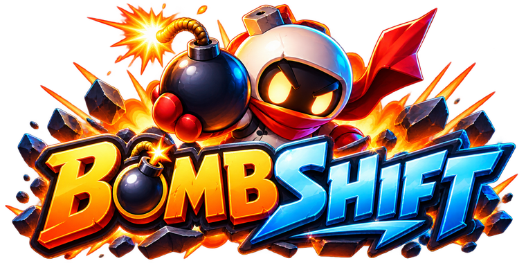
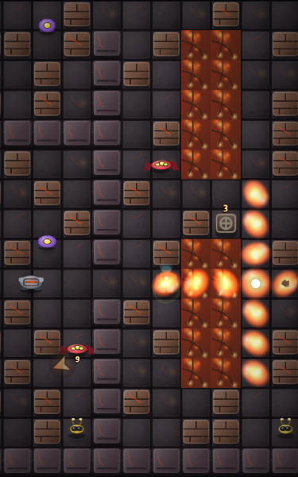
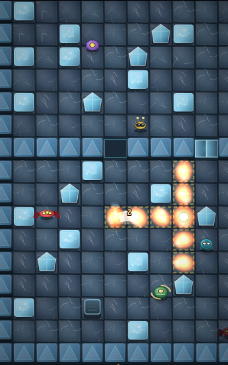
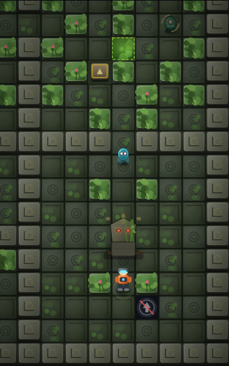

<p align="center">
  
</p>

<p align="center">
  Jeu mobile 2D de labyrinthe a bombes : <b>9 niveaux</b>, <b>3 boss a phases</b>,
  ennemis avec recherche de chemin et evitement de souffle, progression sauvegardee.
  <br />
  Phaser 3 · TypeScript · Vite · pret pour Capacitor (Android / iOS)
</p>

<p align="center">
  
  
  
</p>

<p align="center">
  <b>▶ Jouer en ligne : <a href="https://falmonmickael260-commits.github.io/bombshift/">falmonmickael260-commits.github.io/bombshift</a></b><br />
  <sub>Sur telephone : ouvrez le lien, puis « Ajouter a l'ecran d'accueil » — le jeu s'installe et fonctionne ensuite hors ligne.</sub>
</p>

Une sequence de jeu complete est disponible : [`docs/gameplay.mp4`](docs/gameplay.mp4).

---

## Jouer

- **En ligne** : https://falmonmickael260-commits.github.io/bombshift/
  (deploye automatiquement a chaque push sur `main`, apres typecheck et tests).
- **Installe** : ouvrez ce lien sur telephone et choisissez « Ajouter a l'ecran
  d'accueil ». L'application se lance en plein ecran et fonctionne hors ligne.
- **En natif** : voir la section Capacitor ci-dessous.

## Lancer le jeu en local

```bash
npm install
npm run dev
```

Ouvrez l'adresse affichee (par defaut http://localhost:5180). Sur telephone,
ouvrez la meme adresse depuis le reseau local : le serveur ecoute sur toutes
les interfaces.

```bash
npm run typecheck   # TypeScript strict
npm test            # 77 tests unitaires
npm run build       # verification + build de production dans dist/
npm run preview     # sert le build de production
```

### Installation mobile (Capacitor)

```bash
npm run build
npx cap add android          # et / ou : npx cap add ios
npm run cap:sync
npx cap open android         # ouvre Android Studio
npx cap open ios             # Xcode (macOS + CocoaPods)
```

`capacitor.config.ts` est pret (`appId: com.bombshift.game`, `webDir: dist`).
Le jeu fonctionne entierement **hors ligne** une fois installe.

---

## Commandes

| Action | Tactile | Clavier |
| --- | --- | --- |
| Se deplacer | Joystick flottant : posez le pouce n'importe ou dans la moitie basse de votre cote d'ecran | Fleches / ZQSD |
| Poser une bombe | Gros bouton rouge | Espace |
| Bombe SHIFT (glisse jusqu'a l'obstacle) | Bouton bleu, debloque apres la carte 1 | E |
| Charge lente (longue meche, grande portee) | Bouton bleu, debloque apres la carte 2 | F |
| Pause (avec mini-carte) | Bouton en haut a droite | Echap / P |

Cote du joystick, taille des commandes, difficulte, volumes, niveau d'effets,
secousses, flashs, indices de danger et vibrations sont reglables.

---

## Les neuf niveaux

Trois themes (volcan, glace, temple), chacun decline en trois variantes de
difficulte croissante. Chaque niveau affiche son etiquette **Facile /
Normal / Difficile** dans l'ecran de selection.

| # | Niveau | Difficulte | Mecaniques propres | Boss |
| --- | --- | --- | --- | --- |
| 1 | **La Forteresse Volcanique** | Facile | lave mortelle, events eruptifs cycliques, coulee de lave qui ferme des chemins en cours de partie, 3 valves a activer **dans l'ordre** | **MAGMARON** (6 PV) |
| 2 | **Le Labyrinthe de Glace** | Normal | sols glissants a inertie, bombes qui derapent, portes temporisees en 2 cycles desynchronises, cristaux indestructibles, 3 generateurs a alimenter **par explosion** | **CRYON** (7 PV) |
| 3 | **Le Temple Oublie** | Difficile | dalles piegees a retardement, zones toxiques cycliques, 3 dalles-mecanismes qui ouvrent la chambre centrale, passages secrets, 3 reliques | **LE GARDIEN** (9 PV) |
| 4 | **La Caldeira Oubliee** | Facile | variante volcan allegee (moins de lave, pas d'events) : ideale pour s'entrainer | **MAGMARON** (5 PV) |
| 5 | **Les Cavernes Scintillantes** | Normal | variante glace, meme mecaniques que la carte 2 | **CRYON** (7 PV) |
| 6 | **La Crypte Interdite** | Difficile | variante temple, garde renforcee | **LE GARDIEN** (9 PV) |
| 7 | **La Chambre Ardente** | Normal | volcan a pleine intensite : lave et events au complet, garnison doublee | **MAGMARON** (7 PV) |
| 8 | **Le Glacier Interdit** | Difficile | glace avec portes accelerees | **CRYON** (8 PV) |
| 9 | **Le Dernier Autel** | Difficile | temple avec cycles toxiques accelleres : le defi final | **LE GARDIEN** (10 PV) |

**MAGMARON** : vagues de feu en croix, flaques de lave, invocations, charge.
**CRYON** : glisse et rebondit, **vulnerable seulement apres un impact**,
eclats et murs de glace. **LE GARDIEN** : **vulnerable uniquement les yeux
ouverts**, racines toxiques, ondes circulaires, teleportation, sentinelles,
frenesie.

Deblocage : niveau 1 d'emblee, chaque niveau debloque le suivant une fois
termine (objectifs obligatoires + boss vaincu + sortie atteinte).
Battre la carte 1 (Volcan) debloque la bombe SHIFT, battre la carte 2
(Glace) la charge lente.

Une victoire n'est enregistree qu'apres validation reelle :
objectifs obligatoires **+** boss vaincu **+** contact avec la sortie ouverte.

---

## Regles

- 3 vies par tentative (4 en Detente), invulnerabilite courte apres un degat,
  au depart et a la reprise.
- Explosions en croix, arretees par les murs ; un bloc destructible est
  detruit puis stoppe le souffle (sauf bombe perforante : 1 bloc traverse).
- Une bombe prise dans un souffle **detone en chaine**.
- Le joueur est vulnerable a ses propres bombes. Une bombe ne devient un
  obstacle qu'une fois **entierement** quittee.
- Perdre une vie coute 1 de portee et les charges perforantes ; la carte
  garde son etat. Reapparition sur une case sure proche, jamais dans un
  souffle ni au contact d'un ennemi.
- Bonus : portee, bombe supplementaire, vitesse, bouclier temporaire,
  perforante (3 charges), vie (rare).
- Rang **C a SSS** : objectifs, secrets, temps, degats evites, vies restantes.
  Detruire des blocs ne rapporte rien directement. Le total est pondere par
  la difficulte (x0,8 en Detente, x1,25 en Veteran).

### Confort de jeu

- **Boussole** permanente vers l'objectif courant, **mini-carte** en pause.
- **Conseils contextuels** a la premiere decouverte d'une carte.
- **Reprise de partie** : fermer l'application ne perd plus la tentative
  (grille, objectifs, bonus au sol, ennemis, boss et statistiques restaures).
- Trois niveaux de difficulte, reduction des flashs, indices de danger.

---

## Architecture

```
src/
├── core/        types, constantes, grille + A* + carte de danger, RNG,
│                sauvegarde versionnee (+ instantane de partie), audio
│                procedural, generation des textures
├── gameplay/    joueur, bombes/explosions/chaines, ennemis + IA, boss,
│                bonus, dangers, objectifs, projectiles, score, coach,
│                rendu de la grille
├── maps/        les 9 niveaux (ASCII + reglages) et un parseur qui valide
├── scenes/      BootScene (generation d'art) et GameScene (orchestration)
├── ui/          menus HTML/CSS, HUD, joystick tactile, mini-carte
├── dev/         auto-tests pilotant le jeu reel
└── tests/       tests unitaires (vitest)
```

Choix de conception :

- **Logique pure separee du moteur** : grille, A*, propagation d'explosion,
  score et sauvegarde ne dependent pas de Phaser, donc sont testables seuls.
- Les entites recoivent une interface `World` (jamais la scene) : dependances
  explicites, aucun cycle d'import.
- **Carte de danger** reconstruite chaque frame a partir des bombes posees :
  l'IA ne connait que ce que le joueur voit a l'ecran.
- Budget d'effets reglable et IA cadencee a 6 Hz pour tenir 60 i/s sur mobile
  milieu de gamme ; repli automatique sur le rendu Canvas si le WebGL de
  l'appareil est defaillant.
- **Art et son** : tout est genere par code (textures canvas, musique et
  effets WebAudio). Seul le logo (`public/logo.png`) est un fichier fourni.

---

## Tests

```bash
npm test            # 77 tests unitaires : grille, A*, explosions, IA,
                    # deplacement, score, sauvegarde, validation des cartes
```

En plus, une suite d'auto-tests pilote **le jeu reel** (21 verifications :
collisions, explosions en chaine, degats, ordre des valves, grilles, boss,
victoire, bombe qui derape, dalles piegees, instantane de partie).
Lancez `npm run dev`, ouvrez la console du navigateur et tapez :

```js
await __BOMBSHIFT__.selfTest()
```

## Outils de developpement

`window.__BOMBSHIFT__` (mode dev uniquement) : etat de la partie,
teleportation, pose de bombe, explosion forcee, pas de simulation manuel
(`tick`), inspection de case, `selfTest()`.
`tools/frameSink.ts` enregistre les images du canvas sur disque pour capturer
des sequences de jeu.

## Licence

Code, cartes, personnages, boss, textures et musiques originaux.
